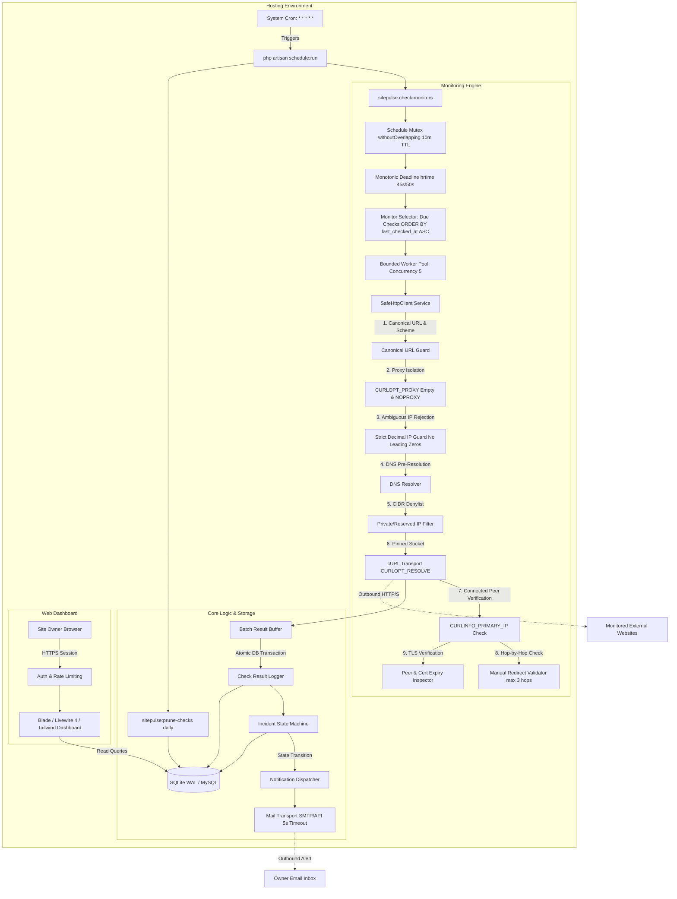
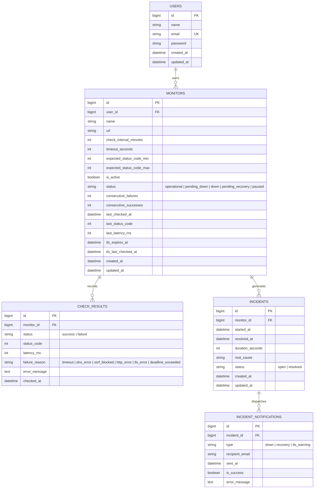

# System Architecture (Proposed)

**Status:** PROPOSED (Phase 00 Final Technical Corrections)  
**Date:** 2026-11-23  

---

## 1. High-Level Architecture

SitePulse is structured as a modular, monolithic Laravel 13 application running on PHP 8.3+, optimized for low operational complexity, high security, and minimal resource utilization.



---

## 2. Core Subsystems & Components

### 2.1 Scheduler, Concurrency, and Deadline Lifecycle
- **Scheduler Entrypoint:** Invoked every 1 minute via system cron (`php artisan schedule:run`).
- **Command:** `sitepulse:check-monitors`.
- **Locking & Mutex Lifecycle (`withoutOverlapping`):**
  - Configured with `withoutOverlapping(10)`.
  - **Important Clarification:** The parameter `10` sets the **cache lock expiration TTL (10 minutes)**, which prevents permanent deadlocks if a process is abruptly terminated (`SIGKILL`). It does **not** enforce a process execution runtime limit.
  - If a previous execution is still running when cron fires, the new invocation detects the active lock, logs an informational notice, and exits cleanly with exit code `0`.
- **Monotonic Execution Deadline:**
  - Wall-clock time can drift or jump; execution time is strictly measured via high-resolution monotonic time (`hrtime(true)`).
  - Target deadline: **45 seconds** from command invocation.
  - Hard deadline ceiling: **50 seconds**.
  - Before picking up any new batch of monitors, the command evaluates:
    ```php
    if (hrtime(true) >= $deadlineNanos) {
        break; // Cease picking up new batches; initiate graceful wrap-up
    }
    ```
- **Cancellation of Outstanding HTTP Handles:**
  - While processing a batch via `curl_multi`, if the hard deadline (50s) is reached:
    - Active easy handles in the multi pool are removed (`curl_multi_remove_handle`) and closed (`curl_close`).
    - Cancelled handles are aborted to ensure the process exits cleanly before the next cron tick.
- **Handling of Partially Completed Batches:**
  - Checks within a batch that completed successfully or failed with confirmed network errors before the deadline are committed in a single database transaction (`DB::transaction`).
  - In-flight checks that were cancelled due to deadline expiration are **not** marked as failed (preventing false outage alerts). Their `last_checked_at` is left untouched, leaving them due for the next cron cycle.
- **Recovery from Forced Termination:**
  - If an execution is terminated abruptly (`SIGKILL`, host process manager):
    - Unchecked or interrupted monitors retain their older `last_checked_at` timestamp.
    - On the subsequent run, due monitors are selected with `ORDER BY last_checked_at ASC NULLS FIRST`, guaranteeing that interrupted checks are prioritized.
    - State transitions in the Incident State Machine only occur on committed check results, preventing ghost outage states.
- **Worker Pool Concurrency:** Bounded pool of **5 concurrent requests** (configurable up to 10 via `SITEPULSE_MAX_CONCURRENCY`).
- **Per-Request Timeouts:** DNS: 2s max; Connect/TLS: 5s max; Total Transfer: 10s default (ceiling: 15s); Body buffer cap: 500 KB.
- **Monitoring History Write Strategy:** Worker results are buffered in memory and committed in a single atomic database transaction (`DB::transaction`) per batch of 5–10 checks, designed to reduce SQLite write lock contention. Performance gains will be measured via benchmarks in Phase 02.

### 2.2 SafeHttpClient Service (SSRF Protection Engine)
The `SafeHttpClient` isolates and enforces:
1. **Strict Canonical URL Validation:** Only lowercase `http://` or `https://`. Rejects credentials in URLs (`user:pass@`). Strictly validates FQDN syntax (RFC 1123).
2. **Rejection of Ambiguous IP Formats:** Does not rely on normalization functions for nonstandard IP representations. Strictly rejects leading zeros (e.g. `0127.0.0.1`), hexadecimal (`0x`), octal, single integer/dword (`2130706433`), and mixed radix notations.
3. **Protocol & Port Allowlist:** Standard web ports `80`, `443`, `8080`, `8443`. Explicit denylist blocks sensitive administrative/database ports (21, 22, 25, 3306, 6379, etc.).
4. **Environment Proxy Isolation:** Explicitly sets `CURLOPT_PROXY => ''` and `CURLOPT_NOPROXY => '*'` to ensure host environment variables cannot route traffic through unintended proxies.
5. **Pre-Flight DNS Resolution & Pinning:** Resolves target hostname into all associated IPv4/IPv6 addresses via `dns_get_record()`. Validates all records against private/reserved CIDRs. Pins socket IP using cURL's `CURLOPT_RESOLVE`.
6. **Connected Peer IP Verification:** Immediately inspects `curl_getinfo($ch, CURLINFO_PRIMARY_IP)` post-connection. If the connected peer IP is in a restricted range or does not match the pinned IP, the response is discarded and the check is aborted.
7. **Manual Hop-by-Hop Redirect Validation:** Automatic redirects are disabled (`CURLOPT_FOLLOWLOCATION = false`). Traverses 3xx redirects manually up to 3 hops with loop detection and full re-validation of each hop URL.
8. **TLS Certificate Validation & Inspection:** Verifies peer certificate (`CURLOPT_SSL_VERIFYPEER = true`), extracts certificate expiration date, and flags certificates expiring within $\le 14$ days.

### 2.3 Incident State Machine
- **States:** `OPERATIONAL`, `PENDING_DOWN`, `DOWN`, `PENDING_RECOVERY`.
- **Transitions:**
  - $N = 2$ consecutive failures required to transition to `DOWN` and open an `Incident`.
  - $M = 2$ consecutive successes required to transition to `OPERATIONAL` and resolve an `Incident`.
- **Alert Generation:** Dispatched exclusively when a transition creates or closes an incident.

### 2.4 Notification Subsystem
- Dispatches transactional alert emails on state transitions.
- Records all sent alerts in `incident_notifications` with unique composite keys `(incident_id, type)` ensuring exact-once notification semantics.
- Outbound SMTP connections bounded by a 5-second socket timeout.

### 2.5 Data Pruning Subsystem
- Daily scheduled task `sitepulse:prune-checks` purges records in `check_results` older than `SITEPULSE_HISTORY_RETENTION_DAYS` (default: 30 days).
- High-level `incidents` records are preserved permanently.

---

## 3. Data Model & Database Schema (Draft)



---

## 4. Measurable Engineering Targets

| Metric | Target | Status & Verification Method |
|---|---|---|
| **CLI Memory Footprint** | $\le 45\text{ MB}$ peak usage | Target to be measured via `memory_get_peak_usage(true)` in CI |
| **Check Latency Budget** | 50 monitors checked in $\le 25\text{ seconds}$ | Target via bounded concurrent worker pool (concurrency 5) |
| **Storage Footprint** | $\le 50\text{ MB}$ for 10 monitors over 30 days | Target under SQLite WAL; measured in Phase 02 |
| **SQLite Lock Contention** | Reduced contention between CLI writes & Web reads | Target via WAL mode, busy timeout, and batch writes; requires Phase 02 benchmarks |
| **Database Portability** | 100% schema parity on SQLite and MySQL 8.0+ | Requires automated CI integration testing |
| **Shared Hosting Compatibility** | Viable operation on CLI-enabled shared hosts | Target requiring empirical deployment testing before release |

---

## 5. Architectural Decision Records (ADRs)
- [ADR-0001: Application Stack and Dependency Compatibility](decisions/ADR-0001-stack.md)
- [ADR-0002: Safe HTTP Client and SSRF Protection](decisions/ADR-0002-safe-http-client.md)
- [ADR-0003: Database Storage Strategy, Concurrency, and Data Retention](decisions/ADR-0003-data-retention-and-storage.md)
- [ADR-0004: Incident State Machine and Notification Strategy](decisions/ADR-0004-incident-state-and-alerts.md)
- Environment Specification: [HOSTING_REQUIREMENTS.md](HOSTING_REQUIREMENTS.md)
