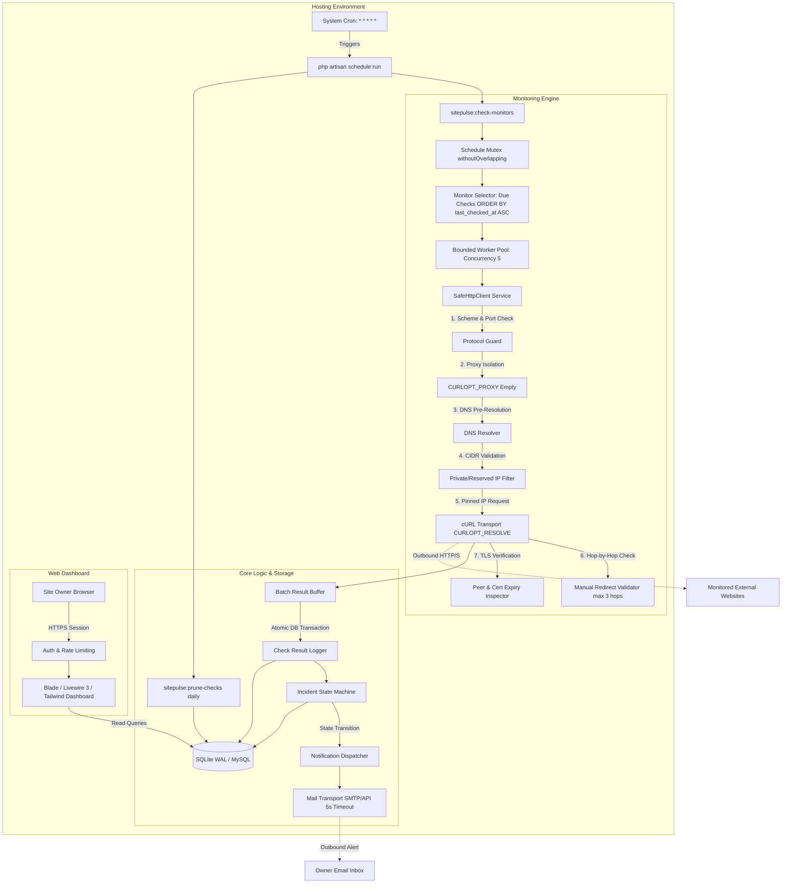
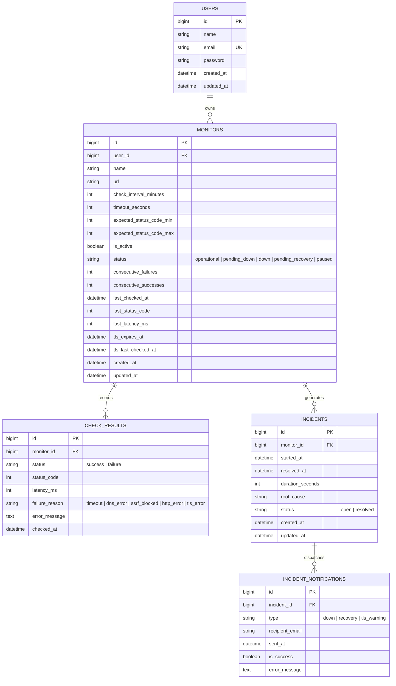

# System Architecture (Proposed)

**Status:** PROPOSED (Phase 00 Architecture Revision)  
**Date:** 2026-11-23  

---

## 1. High-Level Architecture

SitePulse is structured as a modular, monolithic Laravel 13 application running on PHP 8.3+, optimized for low operational complexity, high security, and minimal resource utilization.



---

## 2. Core Subsystems & Components

### 2.1 Scheduler, Concurrency, and Execution Lifecycle
- **Scheduler Entrypoint:** The system scheduler is invoked every 1 minute via system cron (`php artisan schedule:run`).
- **Command:** `sitepulse:check-monitors`.
- **Locking & Overlap Prevention:**
  - Enforces `withoutOverlapping(10)` mutex lock.
  - If a previous check command is still executing when the next cron tick fires, the new execution immediately logs an informational notice and exits cleanly with exit code `0`.
- **Concurrency & Worker Pool:**
  - Checks are executed in bounded concurrent batches of **5 requests** (configurable up to 10 via `SITEPULSE_MAX_CONCURRENCY`).
  - Implemented using asynchronous cURL multi-handles (`curl_multi` / Laravel HTTP client pool) with non-blocking event polling.
- **Per-Request Timeout Budgets:**
  - DNS Resolution Timeout: 2 seconds max.
  - Connection & TLS Handshake Timeout: 5 seconds max.
  - Total Transfer Timeout: 10 seconds default (hard ceiling of 15 seconds).
  - Body Download Cap: 500 KB max (headers and initial payload only).
- **Execution Duration Cap:**
  - Total command execution is hard-capped at **50 seconds**.
  - If `microtime(true) - $startTime > 45` seconds, the command terminates the worker loop cleanly, commits any buffered results, and exits before the next cron tick begins.
- **Recovery from Interrupted Execution:**
  - If a worker process is interrupted (server reboot, OOM, host kill signal):
    - Due monitors that were not evaluated retain their existing `last_checked_at` timestamp.
    - On the subsequent run, monitors are selected with `ORDER BY last_checked_at ASC NULLS FIRST`, ensuring interrupted monitors are prioritized.
    - Incident states transition **only** upon committed check results, ensuring that process interruptions never trigger false or ghost outage alerts.
- **Monitoring History Write Strategy:**
  - Check results are buffered in memory across the worker pool and committed in a single atomic database transaction (`DB::transaction(...)`) per batch.
  - This eliminates SQLite file lock thrashing and ensures consistent persistence.
- **Behavior on Constrained Hosting:**
  - Bounded concurrency of 5 keeps memory usage strictly below 45 MB.
  - Low CPU overhead via non-blocking I/O multiplexing.
  - Compatible with CloudLinux LVE process limits.

### 2.2 SafeHttpClient Service (SSRF Protection Engine)
The `SafeHttpClient` isolates and enforces:
1. **Protocol & Port Allowlist:** Strictly `http://` and `https://`. Standard ports `80`, `443`, `8080`, `8443`. Disallow sensitive administrative/database ports (21, 22, 25, 3306, 6379, etc.).
2. **Environment Proxy Isolation:** Explicitly sets `CURLOPT_PROXY => ''` to prevent inheriting host proxy environment variables (`http_proxy`, `ALL_PROXY`) unless an egress proxy is intentionally configured in `.env`.
3. **Pre-Flight DNS Resolution:** Resolves target hostname into all associated IPv4 and IPv6 addresses via `dns_get_record()`.
4. **IP CIDR Denylist:** Validates all resolved IPs against comprehensive private, loopback, link-local, multicast, and cloud metadata ranges (see `docs/SECURITY.md`).
5. **DNS Rebinding Prevention (Socket Pinning):** Pins the TCP connection to the validated IP address using cURL's `CURLOPT_RESOLVE`, ensuring the socket connects strictly to the pre-verified IP.
6. **Hop-by-Hop Redirect Validation:** Automatic redirects are disabled (`CURLOPT_FOLLOWLOCATION = false`). Traverses 3xx redirects manually up to 3 hops, re-executing DNS and IP validation on each intermediate URL.
7. **TLS Certificate Validation & Inspection:** Verifies peer certificate (`CURLOPT_SSL_VERIFYPEER = true`), extracts certificate expiration date, and flags certificates expiring within $\le 14$ days.

### 2.3 Incident State Machine
Maintains state determinism and prevents alert flapping:
- **States:** `OPERATIONAL`, `PENDING_DOWN`, `DOWN`, `PENDING_RECOVERY`.
- **Transitions:**
  - $N = 2$ consecutive failures required to transition to `DOWN` and open an `Incident`.
  - $M = 2$ consecutive successes required to transition to `OPERATIONAL` and resolve an `Incident`.
- **Alert Generation:** Dispatched exclusively when a transition creates or closes an incident.

### 2.4 Notification Subsystem
- Dispatches transactional alert emails on state transitions.
- Records all sent alerts in `incident_notifications` with unique composite keys `(incident_id, type)` ensuring exact-once notification semantics.
- Outbound SMTP connections are bounded by a 5-second socket timeout so slow or failing mail servers do not disrupt ongoing monitor runs.

### 2.5 Data Pruning Subsystem
- Daily scheduled task `sitepulse:prune-checks` purges records in `check_results` older than `SITEPULSE_HISTORY_RETENTION_DAYS` (default: 30 days).
- High-level `incidents` records are preserved permanently for long-term SLA/uptime reporting.

---

## 3. Data Model & Database Schema (Draft)



---

## 4. Deployment Constraints & Resource Budgets

### Operating Budgets
- **PHP Memory Limit:** Target footprint $\le 45\text{ MB}$; configured for standard $\le 128\text{ MB}$ environments.
- **Execution Time Budget:** 50 monitors checked in $\le 25\text{ seconds}$ via bounded concurrent worker pool (concurrency = 5).
- **Disk Storage:** Under SQLite with 30-day retention, 10 monitors checked every minute produce $\approx 430\text{K}$ rows/month, consuming $\approx 40\text{–}50\text{ MB}$ of disk space.

### SQLite Concurrency Settings
```sql
PRAGMA journal_mode = WAL;
PRAGMA busy_timeout = 5000;
PRAGMA synchronous = NORMAL;
```

---

## 5. Architectural Decision Records (ADRs)
- [ADR-0001: Application Stack and Hosting Constraints](decisions/ADR-0001-stack.md)
- [ADR-0002: Safe HTTP Client and SSRF Protection](decisions/ADR-0002-safe-http-client.md)
- [ADR-0003: Database Engine, Concurrency, and Data Retention](decisions/ADR-0003-data-retention-and-storage.md)
- [ADR-0004: Incident State Machine and Notification Strategy](decisions/ADR-0004-incident-state-and-alerts.md)
- Environment Specification: [HOSTING_REQUIREMENTS.md](HOSTING_REQUIREMENTS.md)
